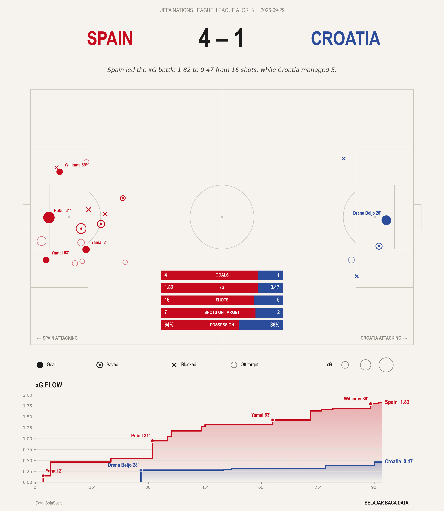
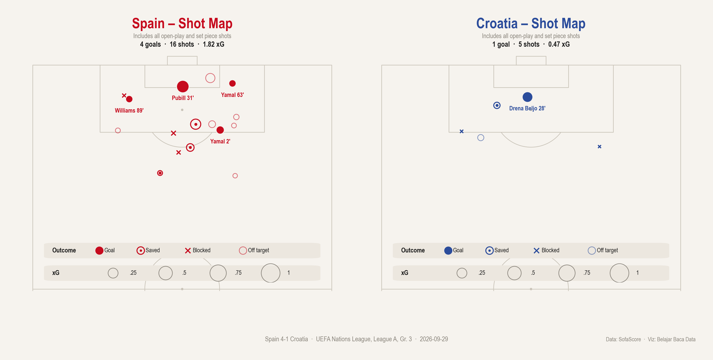

# ⚽ Football Match Report

Pipeline Python end-to-end untuk membuat **match report** sepak bola dari data SofaScore: peta tembakan (shotmap) kedua tim dengan ukuran titik sesuai *expected goals* (xG), perbandingan statistik utama, dan grafik **xG flow** yang menunjukkan kapan setiap tim mendominasi peluang.





## Alur kerja

```
SofaScore ──► scraping ──► data/raw (JSON) ──► processing ──► data/processed (CSV) ──► visualisasi ──► reports/figures (PNG)
```

1. **Scraping** (`src/scraper.py`): membuka halaman pertandingan dengan `undetected-chromedriver`, lalu membaca respons API (shotmap, statistik, info pertandingan) dari log jaringan Chrome.
2. **Processing** (`src/process.py`): mengubah JSON bertingkat menjadi tabel rapi: `shots.csv` (satu baris per tembakan), `stats.csv` (satu baris per statistik), dan `match_info.json`.
3. **Visualisasi** (`src/visualize.py`): membuat match report dengan `mplsoccer` dan `matplotlib`, tersedia dalam bahasa Indonesia (`bahasa="id"`) dan Inggris (`bahasa="en"`). Ada dua output: **match report** (kedua tim dalam satu lapangan + statistik + xG flow) dan **shot map per tim** (dua setengah lapangan vertikal berdampingan).

## Struktur folder

```
football-match-report/
├── data/
│   ├── raw/            # JSON mentah per pertandingan (tidak di-commit)
│   └── processed/      # CSV rapi per pertandingan (tidak di-commit)
├── notebooks/
│   ├── 01_scraping.ipynb
│   └── 02_analisis_visualisasi.ipynb
├── reports/figures/    # hasil visualisasi (PNG)
├── src/
│   ├── scraper.py
│   ├── process.py
│   ├── visualize.py
│   └── pipeline.py     # menjalankan semua tahap sekaligus
├── requirements.txt
└── README.md
```

## Cara menjalankan

Kebutuhan: Python 3.10+ dan Google Chrome.

```bash
pip install -r requirements.txt
```

**Lewat notebook:** jalankan `notebooks/01_scraping.ipynb`, lalu `notebooks/02_analisis_visualisasi.ipynb`.

**Lewat terminal (sekali jalan):**

```bash
python -m src.pipeline "https://www.sofascore.com/football/match/croatia-spain/YTbspUb#id:15534081,tab:statistics" --bahasa id --pembuat "Risna Nurmala"
```

## Cara membaca visualisasi

- Kiri: tembakan tim tuan rumah. Kanan: tembakan tim tamu.
- Bentuk marker = hasil tembakan: bulat penuh (gol, dengan nama dan menit), cincin bertitik (diselamatkan kiper), ✕ (diblok), lingkaran pudar (melenceng).
- Ukuran marker = nilai xG, yaitu peluang sebuah tembakan menjadi gol.
- Panel statistik (tengah bawah lapangan): gol, xG, tembakan, tepat sasaran, penguasaan bola, dan akurasi operan.
- xG flow (bawah): akumulasi xG per menit; lonjakan garis menandai peluang besar, titik menandai gol.

## Insight: Spain 4-1 Croatia

*(Isi dengan temuan Anda dari notebook 02.)*

## Tantangan teknis yang diselesaikan

- **Proteksi bot (HTTP 403 / Cloudflare):** request langsung dengan `curl`/`requests` ditolak, jadi data diambil lewat browser sungguhan (`undetected-chromedriver`).
- **Ketidakcocokan versi ChromeDriver:** versi Chrome dideteksi otomatis lalu diteruskan ke `version_main`.
- **Data API tidak terlihat di HTML:** respons JSON dibaca dari *performance log* Chrome via Chrome DevTools Protocol (`Network.getResponseBody`), dengan cadangan `fetch()` dari dalam browser.
- **Konversi koordinat:** koordinat SofaScore (0–100) dipetakan ke ukuran lapangan StatsBomb (120 × 80) dan dicerminkan untuk tim tamu.

## Catatan data

Data bersumber dari SofaScore dan digunakan untuk tujuan belajar dan portofolio pribadi. Dataset mentah tidak disertakan di repository ini; jalankan pipeline untuk menghasilkannya sendiri.
