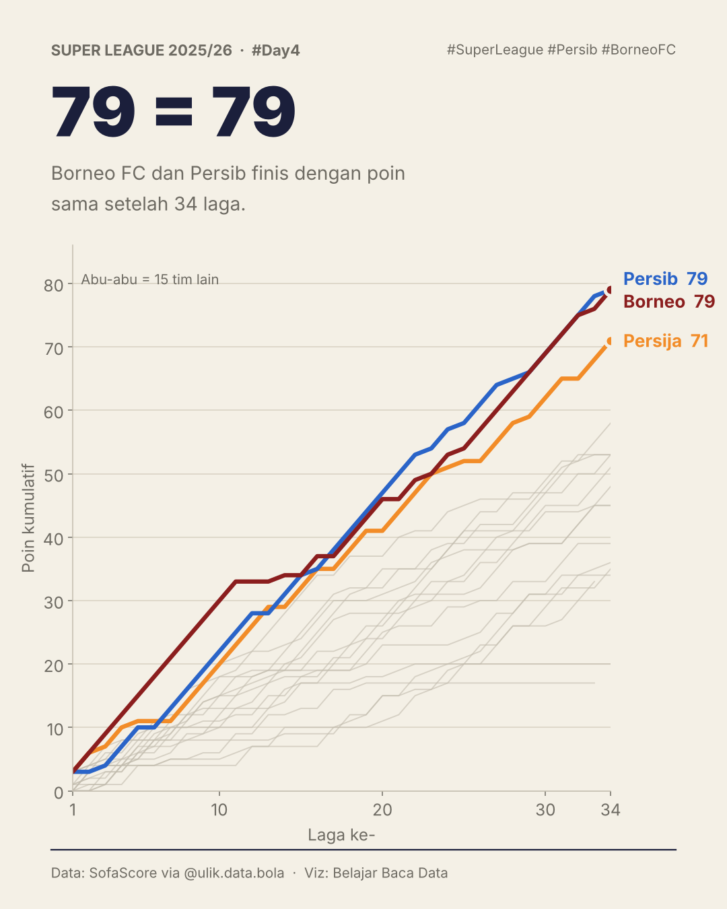
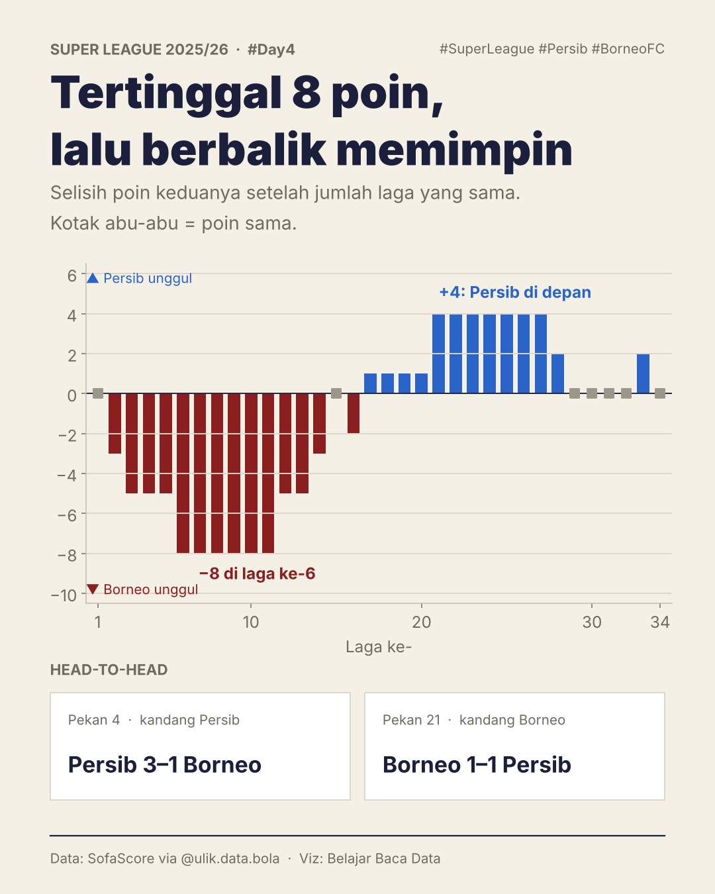
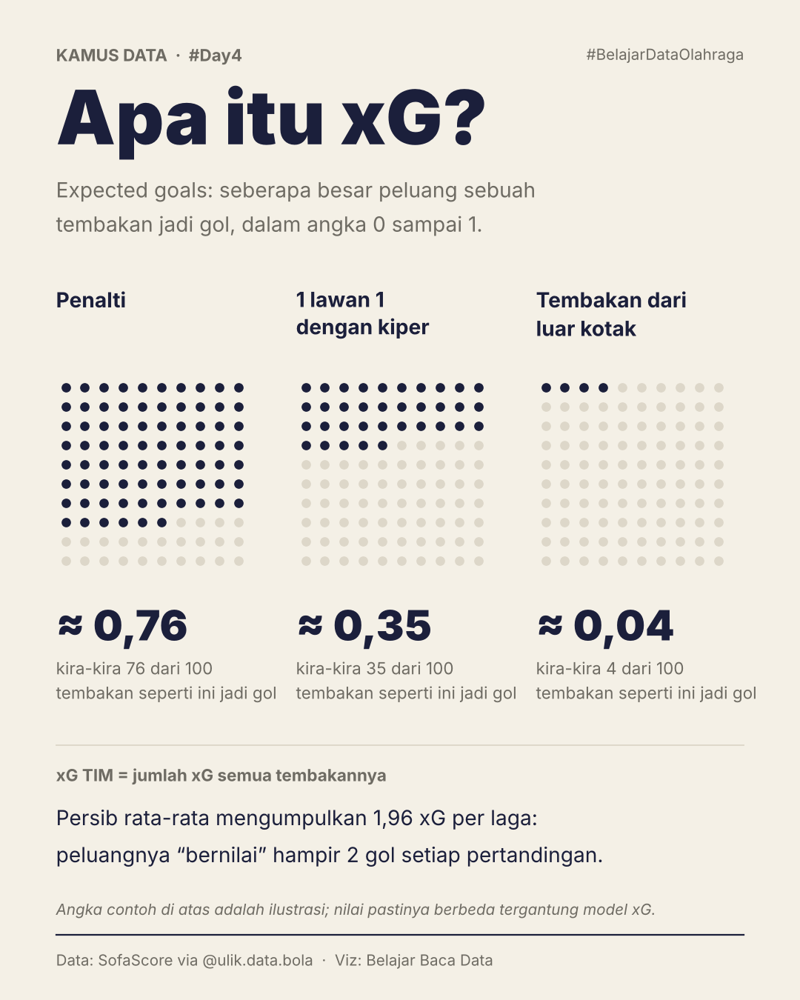

# #Day4 · Perburuan gelar Borneo vs Persib

Super League 2025/26 berakhir dengan Borneo FC dan Persib sama-sama mengumpulkan **79 poin**. Postingan ini membedah jalannya perburuan gelar, lalu memperkenalkan **xG** sebagai jembatan ke #Day5.

## Kartu

| | |
|---|---|
|  | **1. 79 = 79**: poin kumulatif per laga. Garis abu-abu = 15 tim lain. |
|  | **2. Tertinggal 8 poin, lalu berbalik memimpin**: selisih poin Persib − Borneo setelah jumlah laga yang sama, plus head-to-head. |
|  | **3. Apa itu xG?**: kartu "kamus" untuk pembaca awam. |

## Temuan

- Persib tertinggal **8 poin** di laga ke-6, menyamakan di laga ke-15, lalu memimpin hingga **+4** (laga 21–27).
- Di 6 laga terakhir keduanya saling susul dan finis sama-sama 79 poin.
- Head-to-head: Persib menang **3–1** (kandang) dan imbang **1–1** (tandang).

## Caption

```
#Day4 Belajar Data Olahraga ⚽📊

Hari ini kita lihat pola kejar-kejaran poin di Super League 2025/26. Hasilnya: Borneo FC dan Persib sama-sama finis dengan 79 poin.

Persib sempat tertinggal 8 poin, lalu berbalik memimpin 4 poin. Di 6 laga terakhir, keduanya saling susul sampai poinnya sama.

Head-to-head: Persib menang 3–1 dan imbang 1–1.

Tapi poin sama belum tentu permainannya sama. Besok kita bedah pakai xG. Apa itu xG? Cek slide terakhir 👀

Data: SofaScore via @ulik.data.bola
```

## File

- `make_cards.py`: membuat 3 kartu ke `output/`.
- `analysis_season_review.ipynb`: notebook analisis lengkap (perburuan gelar + kuadran xG) yang menjadi dasar #Day4 dan #Day5.

## Catatan metode

- "Laga ke-n" diurutkan per tanggal pertandingan tiap tim (bukan pekan liga), sehingga perbandingan selalu pada jumlah laga yang sama.
- Contoh nilai xG di kartu 3 (penalti ≈ 0,76, dst.) adalah ilustrasi; nilai pastinya bergantung pada model xG.
