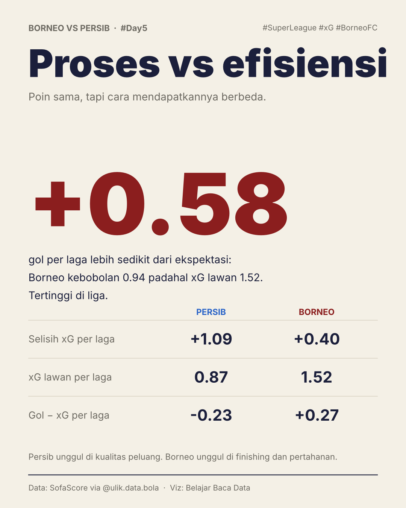
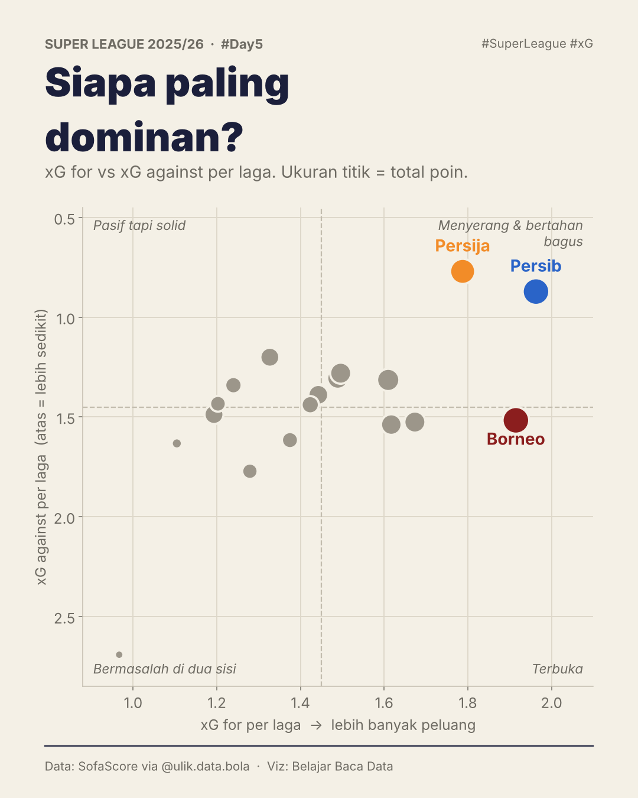
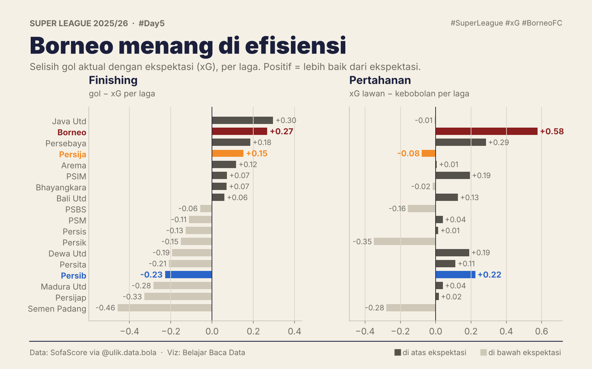
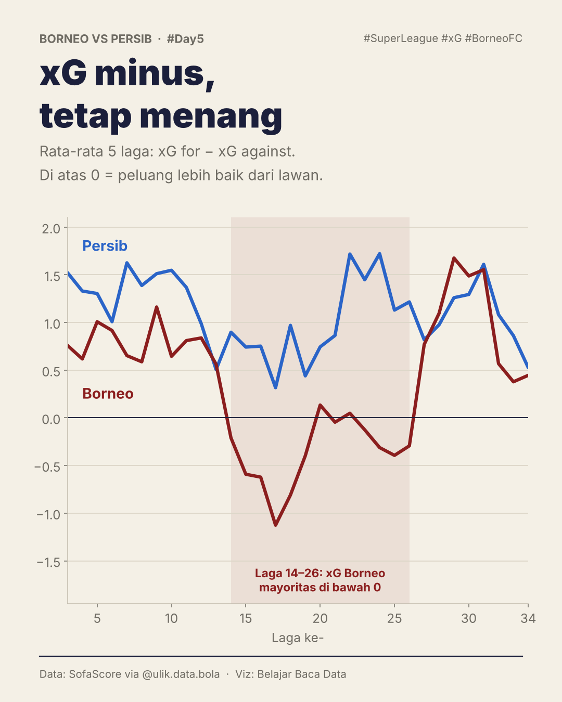

# #Day5 · Borneo vs Persib lewat xG

Poin sama, tapi siapa yang sebenarnya main lebih bagus? Postingan ini membandingkan kualitas peluang (xG) dengan hasil (gol).

## Kartu

| | |
|---|---|
|  | **1. Proses vs efisiensi**: Borneo kebobolan 0,58 gol per laga lebih sedikit dari ekspektasi. |
|  | **2. Siapa paling dominan?**: xG for vs xG against per laga untuk 18 tim. |
|  | **3. Borneo menang di efisiensi** (landscape): finishing & pertahanan dibanding ekspektasi. |
|  | **4. xG minus, tetap menang**: rolling 5 laga selisih xG. |

Urutan carousel: big number → kuadran → over/under → rolling.

## Temuan

- **Persib** punya selisih xG terbaik di liga (**+1,09 per laga**); xG lawan 0,87 per laga (kedua terendah setelah Persija, 0,77).
- **Borneo** kebobolan sekitar **19 gol lebih sedikit** dari xG lawan sepanjang musim (+0,58 per laga, tertinggi di liga).
- **Persib** mencetak sekitar **8 gol lebih sedikit** dari xG-nya (−0,23 per laga).
- Di laga 14–26, rolling xG Borneo sebagian besar di bawah 0, tapi tetap mengumpulkan poin.

## Caption

```
#Day5 Belajar Data Olahraga ⚽📊

Lanjut Borneo vs Persib. Kali ini kita lihat dari xG-nya.

Hasilnya, Persib lebih unggul. Peluangnya paling banyak di liga, dan termasuk tim yang paling sedikit memberi peluang ke lawan.

Borneo kalah soal peluang, tapi lebih efisien: kebobolan sekitar 19 gol lebih sedikit dari peluang lawannya. Sebaliknya, Persib mencetak ±8 gol lebih sedikit dari peluangnya.

Kiper hebat atau sedang beruntung? Menurut kalian?

Data: SofaScore via @ulik.data.bola
```

## Catatan metode

- xG musiman di `team_season_summary.csv` kosong untuk 8 tim karena 1–2 laga tanpa xG. Karena itu semua metrik xG dihitung dari `team_match_summary.csv` sebagai **rata-rata per laga** yang punya data xG.
- Over/underperformance satu musim sebagian dipengaruhi faktor keberuntungan dan kualitas kiper; belum tentu berulang musim berikutnya.
