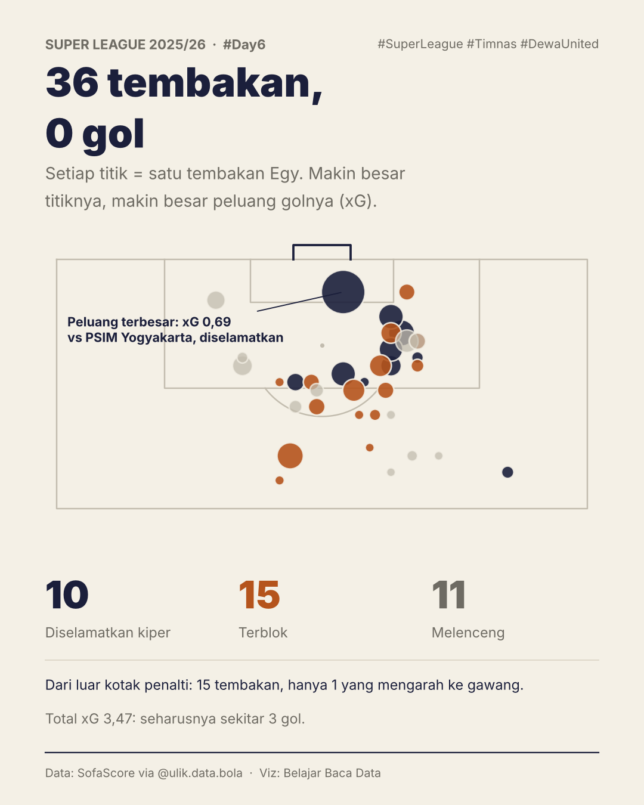
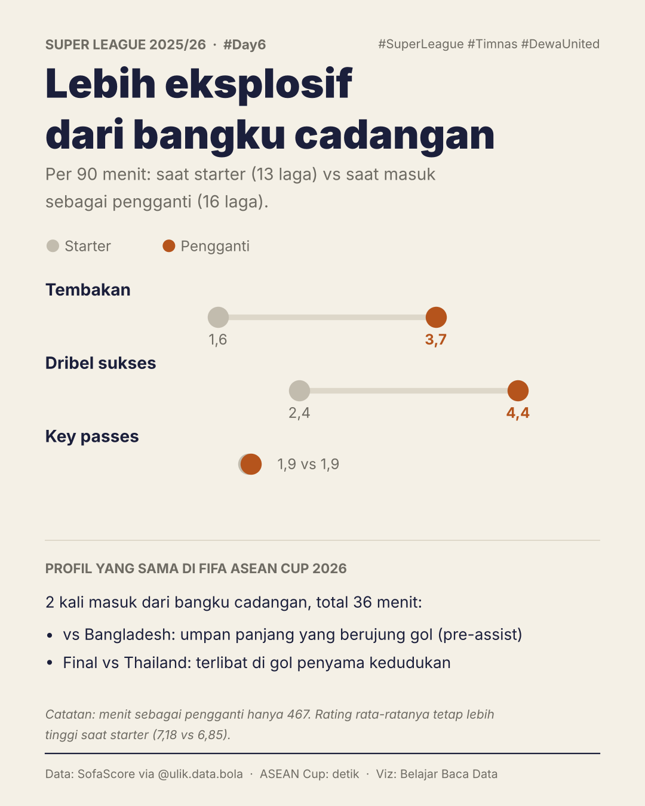
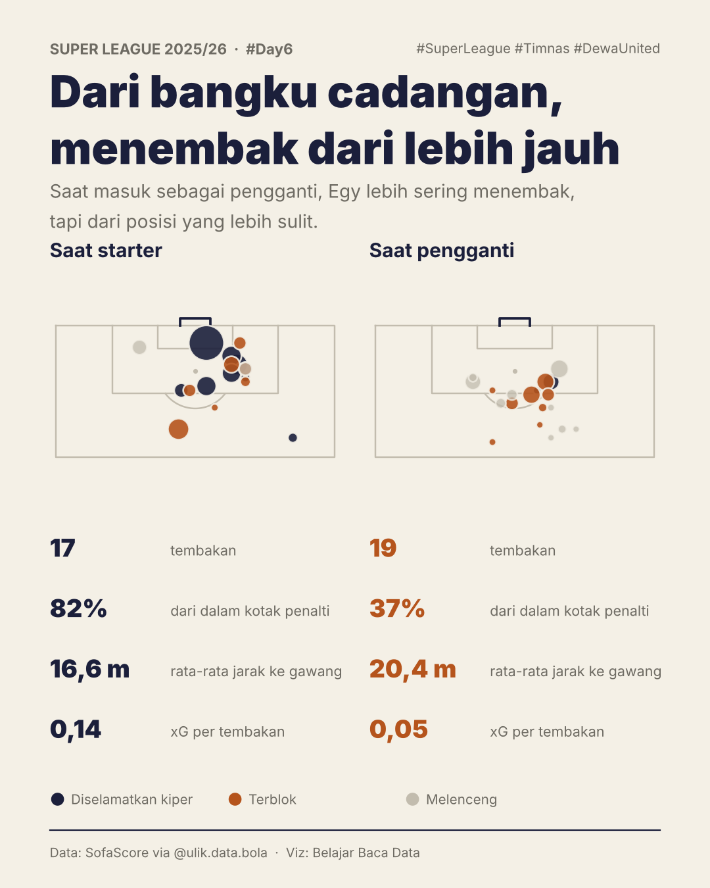

# #Day6 · Egy Maulana Vikri: akhirnya gol lagi

Setelah jadi supersub Timnas di FIFA ASEAN Cup 2026, Egy Maulana Vikri mencetak gol ke gawang Persib (11 Oktober 2026), gol liga pertamanya setelah 29 laga. Postingan ini membedah kenapa puasa golnya selama itu, memakai data Super League 2025/26 dan shot map 36 tembakannya.

## Kartu

| | |
|---|---|
|  | **1. Poster**: akhirnya gol lagi, 29 laga tanpa gol, supersub Timnas. |
|  | **2. 36 tembakan, 0 gol**: shot map musim 2025/26 (ukuran = xG, warna = hasil). |
|  | **3. Lebih eksplosif dari bangku cadangan**: per 90 menit, starter vs pengganti. |
|  | **4. Dari bangku cadangan, menembak dari lebih jauh**: shot map starter vs pengganti. |

## Temuan (Super League 2025/26)

- 29 penampilan (13 starter, 16 pengganti), 1.411 menit, **0 gol**, 1 assist.
- **36 tembakan, total xG 3,46**: 10 diselamatkan, 15 terblok, 11 melenceng; 35 dari 36 memakai kaki kiri.
- **15 tembakan dari luar kotak penalti, hanya 1 yang mengarah ke gawang.**
- Peluang terbesar: xG 0,69 vs PSIM Yogyakarta, diselamatkan kiper.
- Saat pengganti: lebih sering menembak (3,7 vs 1,6 per 90) dan menggiring bola (4,4 vs 2,4 per 90), tapi hanya **37%** tembakan dari dalam kotak (vs **82%** saat starter) dan xG per tembakan **0,05** (vs 0,14).

## Caption

```
#Day6 Belajar Data Olahraga ⚽📊

Setelah sukses jadi supersub Timnas di ASEAN Cup 2026, Egy Maulana Vikri akhirnya cetak gol lagi ke gawang Persib (11/10). Gol liga pertamanya setelah 29 laga.

Pertanyaannya: kenapa puasa golnya selama itu?

Musim lalu: 36 tembakan senilai 3,46 xG, tapi 0 gol. 15 tembakan dari luar kotak, cuma 1 yang mengarah ke gawang.

Akankah ini jadi awal kebangkitannya, atau sekadar momen? 👀

Data: SofaScore via @ulik.data.bola
```

## File

- `make_poster.py`: poster pembuka (butuh 2 foto di `photos/`, lihat di bawah).
- `make_cards.py`: kartu 2–4 (butuh `player_*_summary.csv` dan `egy_shotmap_2526.csv` di `data/`).
- `scrape/egy_shotmap_console.js`: pengambil shot map.

## Cara mengambil shot map

SofaScore menolak permintaan dari script (403), tapi mengizinkan browser biasa. Jadi shot map diambil dari dalam Chrome:

1. Buka `https://www.sofascore.com` di Chrome.
2. Buka Console (Cmd + Option + J), ketik `allow pasting` bila diminta.
3. Tempel isi `scrape/egy_shotmap_console.js`, tekan Enter.
4. `egy_shotmap_2526.csv` terunduh otomatis; pindahkan ke `data/`.

Untuk pemain lain, ganti `PLAYER_ID` dan daftar `ids` (diambil dari kolom `match_id` di `player_match_summary.csv`).

## Foto

Foto tidak disertakan di repo karena hak ciptanya milik media. Simpan sendiri ke `photos/`:

- `photos/egy_dewa.png`: foto selebrasi Egy (JawaPos.com)
- `photos/egy_timnas.png`: Egy vs Bangladesh (KOMPAS.com/Adil Nursalam)

## Catatan metode

- Koordinat SofaScore: `x` = jarak dari garis gawang (% panjang lapangan), `y` = posisi melebar (% lebar). Diasumsikan `y > 50` = sisi kanan dari sudut pandang penyerang. Lapangan dikonversi ke 105 × 68 m.
- "Dalam kotak penalti" = ≤ 16,5 m dari garis gawang dan dalam lebar 40,32 m.
- Fakta musim 2026/27 dan ASEAN Cup 2026 berasal dari berita (iNews, VIVA, detik), bukan dari dataset.
- Statistik per 90 menit untuk pemain pengganti cenderung tinggi (menit sedikit, lawan sudah lelah); sampel pengganti hanya 467 menit.
